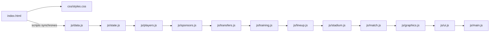
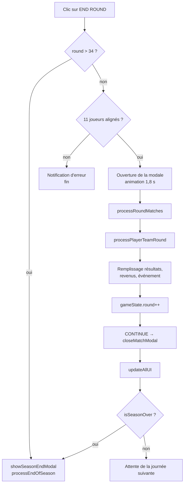
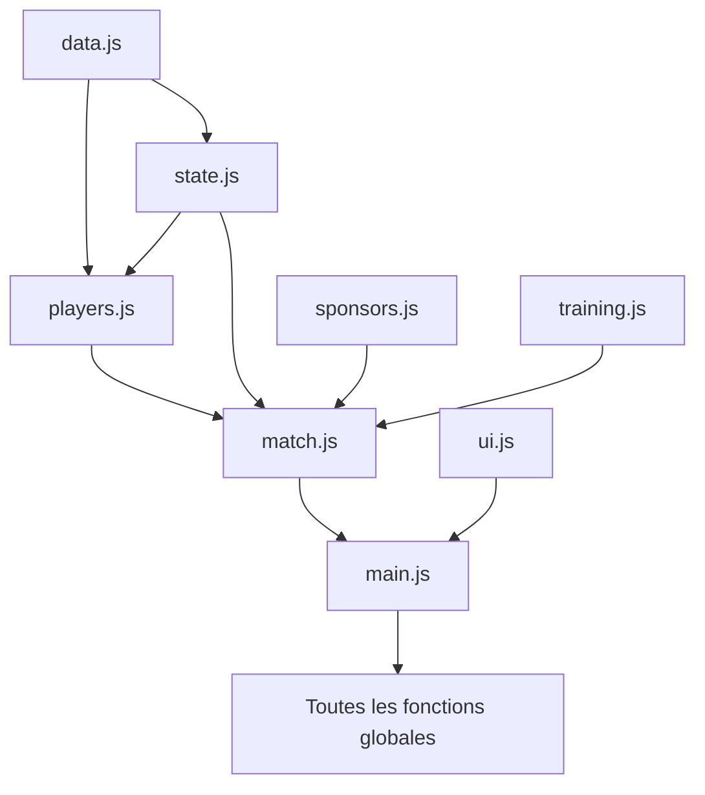

# 🏗️ Architecture technique

## 1. Vue d'ensemble

Le projet est une application **statique mono-page** :

- `index.html` contient toute la structure DOM (écran d'intro, jeu, modales).
- `css/styles.css` contient l'intégralité du thème (CRT, composants, responsive).
- `js/*.js` contient la logique, découpée par domaine.
- Aucun bundler, aucun `package.json`, aucune étape de compilation.

Le navigateur charge les scripts dans l'ordre déclaré dans `index.html`, puis `main.js` initialise le jeu au `DOMContentLoaded`.



## 2. Arborescence

```text
open-football-simulation/
├── index.html          # Structure de l'interface et ordre des scripts
├── css/
│   └── styles.css      # Thème rétro, composants, responsive
├── js/
│   ├── data.js         # Constantes et données statiques
│   ├── state.js        # État global gameState + sauvegarde/chargement
│   ├── players.js      # Génération, vieillissement, valeur des joueurs
│   ├── sponsors.js     # Offres, contrats et paiements des sponsors
│   ├── transfers.js    # Marché des transferts
│   ├── training.js     # Stages d'entraînement
│   ├── lineup.js       # Composition et sélection automatique
│   ├── stadium.js      # Capacité, billetterie, revenus
│   ├── match.js        # Calendrier, simulation, fin de saison
│   ├── graphics.js     # Rendu SVG du maillot et du stade
│   ├── ui.js           # Rendu des tableaux, notifications, ticker
│   └── main.js         # Contrôleur : init, événements, enchaînement
├── doc/                # Cette documentation
├── README.md
└── LICENSE
```

> Le README d'origine mentionne un dossier `assets/` et une arborescence `football-manager-v2/` : ces éléments n'existent pas dans le dépôt actuel.

## 3. Modèle d'exécution

### Scripts classiques, pas de modules

Tous les fichiers sont chargés comme des scripts classiques :

```html
<script src="js/data.js"></script>
<script src="js/state.js"></script>
<!-- … -->
<script src="js/main.js"></script>
```

Conséquences :

- Les fonctions déclarées avec `function` deviennent **globales** et sont appelées directement depuis les autres fichiers (`calculatePlayerValue()`, `showNotification()`, etc.).
- L'ordre des balises `<script>` est **critique** : chaque fichier suppose que les fonctions/constantes des fichiers précédents existent déjà.
- Les gestionnaires inline du HTML (`onclick="saveGame()"`, `onchange="toggleLineup(...)"`) dépendent de ces globales.
- Les blocs `if (typeof module !== 'undefined' && module.exports)` en fin de fichier sont **inertes dans le navigateur** et ne permettent pas réellement d'utiliser les fichiers avec Node.js (voir §8).

### Point d'entrée

`main.js` enregistre :

```js
document.addEventListener('DOMContentLoaded', initGame);
```

`initGame()` :

1. `generateTeams()` — crée 18 clubs et leurs effectifs.
2. `populateTeamSelect()` — construit la grille de choix du club.
3. `setupEventListeners()` — branche les boutons, onglets, curseurs et inputs fichier.

`startGame()` applique ensuite le bonus du club joueur, calcule les valeurs, sélectionne un XI, génère le calendrier, les offres de sponsors et le marché des transferts, puis affiche l'interface.

## 4. Rôle des modules

| Fichier | Responsabilité | Fonctions principales |
|---|---|---|
| `data.js` | Constantes pures : noms, sponsors, formations, événements | `TEAM_NAMES`, `TRAINING_CONFIG`, `RANDOM_EVENTS`, `STADIUM_EXPANSIONS` |
| `state.js` | État central, accès au club joueur, classement, save/load | `createInitialState()`, `getPlayerTeam()`, `getLeaguePosition()`, `saveGame()`, `loadGame()` |
| `players.js` | Génération et évolution des joueurs/équipes | `generatePlayer()`, `generateSquad()`, `generateTeams()`, `ageAllPlayers()`, `refreshAllPlayers()` |
| `sponsors.js` | Offres, signature, paiements par journée | `generateSponsorOffers()`, `acceptSponsor()`, `processSponsorPayments()` |
| `transfers.js` | Marché, achats, ventes, rafraîchissement | `generateTransferMarket()`, `buyPlayer()`, `sellPlayer()`, `refreshMarket()` |
| `training.js` | Sélection et application des stages | `selectTrainingType()`, `sendToTraining()`, `processTrainingEffects()` |
| `lineup.js` | Composition manuelle et automatique | `toggleLineup()`, `autoSelectLineup()`, `autoSelectFreshXI()`, `isLineupValid()` |
| `stadium.js` | Billetterie, affluence, extension | `calculateExpectedAttendance()`, `setTicketPrice()`, `expandStadium()` |
| `match.js` | Calendrier, simulation, revenus, fin de saison | `generateFixtures()`, `simulateMatch()`, `processRoundMatches()`, `processEndOfSeason()` |
| `graphics.js` | SVG du maillot, affichage des sponsors, revenus estimés | `renderKitDisplay()`, `updateStadiumGraphics()`, `renderIncomeBreakdown()` |
| `ui.js` | Mise à jour de toutes les vues, tri, notifications | `updateAllUI()`, `updateSquadTable()`, `updateLeagueTable()`, `showNotification()` |
| `main.js` | Orchestration et événements | `initGame()`, `startGame()`, `endRound()`, `closeMatchModal()` |

## 5. `gameState` : la source de vérité

Tout l'état de la partie tient dans un seul objet global, créé par `state.js` :

```js
let gameState = createInitialState();
```

Il contient :

- l'index du club joueur (`playerTeamIndex`) ;
- la saison et la journée (`season`, `round`) ;
- le budget et les revenus (`budget`, `weeklyIncome`, `lastIncomeBreakdown`) ;
- les 18 équipes et leurs joueurs (`teams`) ;
- le marché (`transferMarket`) ;
- les sponsors actifs et les offres (`sponsors`, `sponsorOffers`) ;
- le stade et le maillot (`stadium`, `kit`) ;
- le calendrier (`fixtures`) ;
- la composition et l'entraînement (`selectedLineup`, `trainingQueue`, `selectedTrainingType`) ;
- l'historique des messages (`messageLog`, 100 entrées max).

Il n'y a **ni store, ni événement, ni réactivité** : après chaque action, le code appelle explicitement `updateAllUI()`, qui recharge toutes les vues. C'est simple et prévisible, mais coûteux et facile à oublier.

## 6. Cycle d'une journée



Détail des étapes :

1. `endRound()` vérifie d'abord `isSeasonOver()` (`round > 34`), puis `isLineupValid()`.
2. La simulation est différée de 1,8 s par `setTimeout` pour l'effet dramatique.
3. `processRoundMatches()` simule les 9 matchs de la journée, met à jour les statistiques et renvoie le match du joueur.
4. `processPlayerTeamRound()` encaisse les sponsors, la billetterie (si match à domicile), applique l'entraînement, la fatigue, les blessures, la progression, les jeunes et les événements aléatoires.
5. La modale affiche le score du joueur, les autres résultats, le détail des revenus et l'éventuel événement.
6. `gameState.round` est incrémenté.
7. À la fermeture, `closeMatchModal()` rafraîchit l'UI et déclenche la fin de saison si nécessaire.

⚠️ `endRound()` ne désactive pas le bouton pendant l'animation : un double-clic peut lancer deux simulations.

## 7. Cycle d'une saison

`processEndOfSeason()` exécute, dans l'ordre :

1. Calcul du classement final (points, différence de buts, buts marqués).
2. Position du club joueur et détection de relégation (`isPlayerRelegated`, **non exploitée**).
3. Remplacement des **2 derniers clubs IA** par des clubs promus générés aléatoirement.
4. Attribution du prize money (5 M€ pour le champion, jusqu'à 250 k€).
5. Vieillissement de tous les joueurs, retraites éventuelles, baisse de force des vétérans.
6. Réinitialisation énergie/condition de tous les joueurs.
7. Remise à zéro des statistiques d'équipe.
8. Nouveau calendrier, nouvelles offres de sponsors, nouveau marché.
9. Vidage de la composition, `season++`, `round = 1`.
10. Recalcul des valeurs de tous les joueurs.

La modale de fin de saison affiche la position, le prize money et les clubs relégués. `closeSeasonEndModal()` relance ensuite une sélection automatique du XI.

## 8. Sauvegarde et chargement

- **Sauvegarde** : `saveGame()` sérialise `gameState` en JSON et déclenche un téléchargement navigateur nommé `onlinefootballsimulation-save-s{season}r{round}.json`.
- **Chargement** : `loadGame(file)` lit le fichier via `FileReader`, fait `JSON.parse`, remplace `gameState`, masque l'intro, affiche le jeu et appelle `updateAllUI()`.

Il n'y a **aucune validation de schéma, aucun numéro de version et aucune migration**. Voir [save-format.md](save-format.md).

## 9. Dépendances et couplage



Le couplage est **fort et implicite** :

- `match.js` appelle directement des fonctions de `sponsors.js`, `training.js` et `ui.js`.
- `ui.js` lit et écrit `gameState` et appelle des fonctions de presque tous les modules.
- Aucun module ne déclare ses dépendances ; elles existent uniquement par convention et par ordre de chargement.

## 10. Limites d'architecture

| Limite | Conséquence |
|---|---|
| Globales partout | collisions de noms, dépendances invisibles, ordre de chargement fragile |
| `module.exports` décoratif | impossible de tester les modules isolément avec Node.js |
| Pas de séparation état/rendu | chaque action doit penser à appeler `updateAllUI()` |
| `innerHTML` massif | risque XSS si des données externes (sauvegarde) sont injectées, et rerender complet |
| Pas de tests ni de lint | régressions silencieuses, bugs de calendrier/économie non détectés |
| Pas de version de sauvegarde | les anciens fichiers peuvent casser le jeu |
| Aucune persistance automatique | fermer l'onglet perd la partie si on n'a pas exporté |

Ces limites sont acceptables pour un prototype, mais deviennent bloquantes dès qu'on veut ajouter des fonctionnalités ou équilibrer le jeu. Les pistes de refactor sont détaillées dans [development.md](development.md#pistes-damélioration).
